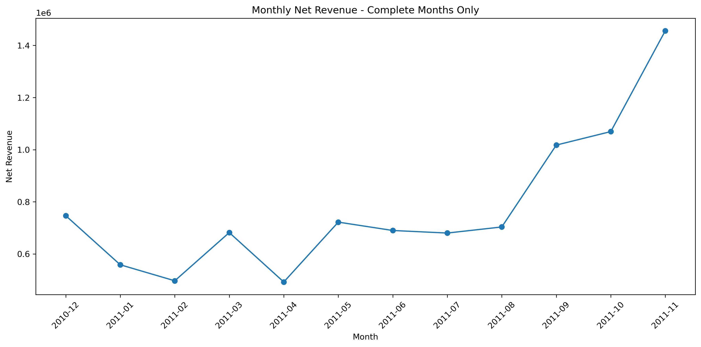
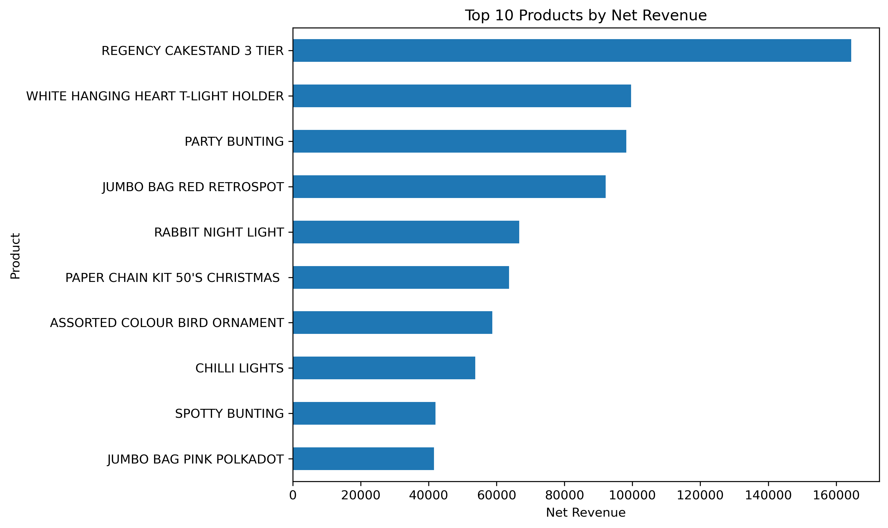
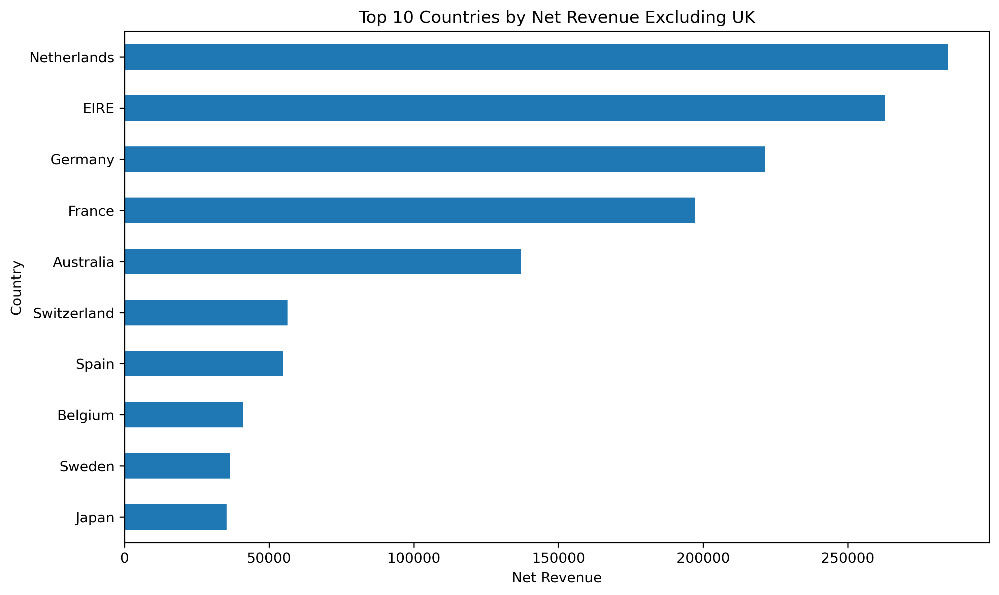

# E-Commerce Sales & Customer Analysis

## Project Overview

This project analyzes transactional data from the UCI Online Retail dataset using Python.

The objective is to clean and validate the dataset, calculate accurate financial KPIs, analyze product and customer performance, identify international market trends, and extract business insights.

A key part of the analysis was correctly handling returns and cancelled transactions. Instead of simply removing negative quantities, cancellations were retained in the financial analysis to calculate accurate net revenue.

---

## Tools & Technologies

- Python
- Pandas
- NumPy
- Matplotlib
- Jupyter Notebook
- Git
- GitHub

---

## Dataset

The project uses the **Online Retail** dataset from the UCI Machine Learning Repository.

The dataset contains transactional records from a UK-based online retailer between:

- Start date: 1 December 2010
- End date: 9 December 2011

Main variables include:

- Invoice number
- Product code
- Product description
- Quantity
- Invoice date
- Unit price
- Customer ID
- Country

The raw dataset is not included in this repository.

Dataset source:

https://archive.ics.uci.edu/dataset/352/online+retail

---

## Project Workflow

### 1. Data Exploration

The dataset was initially inspected for:

- Dataset dimensions
- Missing values
- Duplicate records
- Data types
- Invalid prices
- Negative quantities
- Cancelled invoices
- Extreme transactions

---

### 2. Data Cleaning

The following cleaning steps were applied:

- Removed exact duplicate records
- Removed records with zero or negative unit prices
- Retained negative quantities representing returns and cancellations
- Created separate datasets for financial, customer, and product analysis
- Removed administrative transaction codes from product rankings
- Removed missing Customer IDs from customer-level analysis

---

### 3. Revenue Calculation

Revenue was calculated as:

`Revenue = Quantity × Unit Price`

Negative quantities were retained when calculating net revenue.

This was important because some very large purchases were later fully cancelled.

The analysis therefore distinguishes between:

- Gross Sales
- Returns / Cancellations
- Net Revenue

---

## Key Performance Indicators

| KPI | Result |
|---|---:|
| Rows analyzed | 534,129 |
| Gross Sales | £10,642,110.80 |
| Returns / Cancellations | £893,979.73 |
| Net Revenue | £9,748,131.07 |
| Unique Invoices | 23,796 |
| Customers | 4,371 |
| Cancellation Rate | 14.81% |

The cancellation rate represents the percentage of unique invoices identified as cancellation invoices.

---

## Monthly Revenue Analysis

December 2011 was excluded from full-month trend comparisons because the dataset only contains transactions up to 9 December 2011.



### Insight

November 2011 was the strongest complete month, generating approximately **£1.46 million in net revenue**.

Revenue increased significantly from September through November, suggesting strong seasonal demand during the final months of the year.

---

## Product Performance

Administrative transaction codes such as postage, manual adjustments, discounts, carriage charges, and other non-product records were excluded from product rankings.



### Top Products by Net Revenue

1. Regency Cakestand 3 Tier
2. White Hanging Heart T-Light Holder
3. Party Bunting
4. Jumbo Bag Red Retrospot
5. Rabbit Night Light

**Regency Cakestand 3 Tier** generated approximately **£164,459** in net revenue, making it the highest-revenue actual product in the dataset.

---

## International Market Analysis

The United Kingdom dominates the dataset, so international market performance was also analyzed separately.



The strongest non-UK markets were:

1. Netherlands
2. EIRE
3. Germany
4. France
5. Australia

The Netherlands generated the highest net revenue among international markets.

---

## Customer Analysis

Customer-level net revenue was calculated using transactions with valid Customer IDs.

The highest-value customers included:

| Customer ID | Net Revenue |
|---|---:|
| 14646 | £279,489.02 |
| 18102 | £256,438.49 |
| 17450 | £187,322.17 |
| 14911 | £132,458.73 |
| 12415 | £123,725.45 |

Customer **14646** generated approximately **£279k** in net revenue.

The results indicate that a relatively small group of customers contributes a substantial amount of total revenue.

---

## Key Business Insights

- Net revenue reached approximately **£9.75M** after accounting for returns and cancellations.
- Returns and cancellations represented a significant portion of gross sales and therefore should not be ignored during revenue analysis.
- November 2011 was the strongest complete month with approximately **£1.46M** in net revenue.
- Revenue increased sharply between September and November, indicating strong Q4 seasonality.
- The Netherlands was the strongest international market outside the UK.
- Regency Cakestand 3 Tier was the highest-revenue actual product after removing non-product transaction codes.
- Customer 14646 generated the highest customer-level net revenue at approximately **£279k**.
- Large cancelled transactions showed why blindly removing negative quantities can significantly overstate business performance.

---

## Repository Structure

```text
ecommerce-sales-analysis/
│
├── images/
│   ├── monthly_net_revenue.png
│   ├── top_countries_net_revenue.png
│   └── top_products_net_revenue.png
│
├── notebooks/
│   └── ecommerce_sales_analysis_corrected.ipynb
│
├── .gitignore
└── README.md